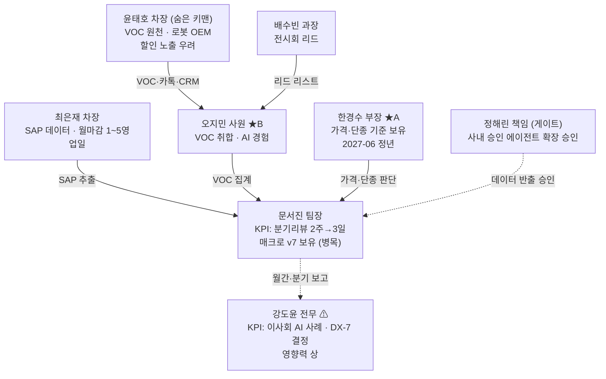

# 4주차: 토폴로지 스캔 (고객사 진입)

- **모듈:** M4
- **근거 영상:** 10-05, 08-12
- **이어받는 것:** 1주차 이해관계자 가설과 질문 10개, 3주차 데이터 등급 매트릭스 v0
- **넘기는 것:** 토폴로지 맵 v2, 메인테이너 후보, 확정된 데이터 등급표 → 5주차 문제 정의, 8주차와 12주차 메인테이너 선정

---

## A. 실습 자료

### 진행 방식 (롤플레이)
- 강사들이 `instructor/case_secrets.md`의 인물을 연기합니다.
- 수강생은 1인 FDE로 혼자 인터뷰합니다.

| 날 | 일정 |
|---|---|
| 1일차 | 강도윤, 문서진, 한경수와 각 45분 인터뷰 → 토폴로지 맵 v1 |
| 2일차 | 오지민, 배수빈, 최은재, 정해린 중 3명 이상과 인터뷰. **추가 인터뷰를 요청할 권한이 있습니다** → 맵 v2 |
| 3일차 | 문서진 팀장과 맵을 함께 검토 (30분) |

**이벤트:** 1일차 인물 목록에 윤태호 차장이 없습니다.

### 인터뷰 가이드 (수강생 배포용)
- 1주차 질문 10개를 재사용합니다.
- 인물마다 다음 세 가지를 꼭 묻습니다.
  1. 이 일이 잘되면 누구에게 칭찬받나요?
  2. 지금 가장 시간이 많이 드는 일은 무엇인가요?
  3. 이 데이터는 누구에게서 받나요?
- 3주차 데이터 등급 매트릭스를 들고 가서 정해린 책임에게 확인받습니다.

### 맵 작성 규칙
- **노드:** 인물. 역할, 진짜 KPI, 영향력(상/중/하)을 적습니다.
- **선:** 데이터 흐름(→)과 보고 흐름(⇢)을 구분합니다.
- 메인테이너 후보를 ★로 표시합니다.
- 프로젝트가 실패할 때 가장 곤란해지는 사람을 ⚠로 표시합니다.

### 제출 양식
```
4-1_토폴로지맵_v1.md, 4-1_토폴로지맵_v2.md  (mermaid 다이어그램 + 변경 이유)
4-2_인터뷰노트.md
4-3_데이터등급표_확정.md
```

### 평가 포인트 (강사 체크리스트)
- [ ] 윤태호 차장을 찾아 인터뷰를 요청했는가 (**핵심**)
- [ ] 강 전무의 진짜 KPI("이사회 사례 1건, DX-7 결정")를 끌어냈는가
- [ ] 문 팀장에게서 "하나만 된다면"이라는 질문으로 진짜 우선순위를 얻었는가
- [ ] 한 부장에게 "자동화"가 아니라 "방식을 남기기"로 접근했는가
- [ ] 정 책임에게서 사내 승인 에이전트의 존재와 확장 조건을 알아냈는가
- [ ] 메인테이너 후보를 2명(시니어와 주니어) 제시했는가

---

## B. 예상 산출물

### 4-1. 토폴로지 맵 v2 (모범 답안)



**v1 → v2에서 바뀐 점과 이유**

| 변경 | 이유 |
|---|---|
| 윤태호 차장 추가 | 오지민 인터뷰에서 "VOC는 윤 차장님이 영업사원들한테 모아서 줘요"를 확인했습니다. 3주차 매트릭스의 "VOC 소유자 미상"이 해소되었습니다 |
| 정해린을 게이트로 표시 | R&D용 사내 승인 에이전트가 이미 있습니다. 확장 신청서와 데이터 분류표가 필요합니다 |
| 강 전무의 KPI 수정 | "리포트 자동화"가 아니라 "이사회 사례와 DX-7 결정"입니다. 세온 RFQ(7/31)를 언급했습니다 |
| 문 팀장을 병목으로 표시 | 매크로를 혼자 관리하고 있습니다. "하나만 된다면 VOC와 분기 리뷰"라고 답했습니다 |

**메인테이너 후보**
- **★A 한경수 부장:** 도메인 지식이 가장 많습니다. 2027년 6월 정년이라 기간 리스크가 있습니다.
- **★B 오지민 사원:** 실무와 데이터 원천을 압니다. 주니어로서 유지보수를 하며 도메인을 익힐 수 있습니다 (08-12).
- **권고:** 오지민을 주 메인테이너로, 한경수를 지식 검토자로 둡니다. 이 구조가 12주차 이벤트(한 부장 휴직)에 대한 대비책이 됩니다.

**"왜 우리에게 맡겼나" 메타인지 (10-05)**
- 내부 역량은 충분합니다. 다만 영업과 상품기획 사이의 데이터 공유를 내부 사람이 꺼내기 어렵습니다(정치).
- 팀장은 바빠서 직접 바꿀 시간이 없습니다.
- → **FDE의 역할은 외부 드라이버로서 두 부서 사이를 중재하는 것입니다.**

### 4-3. 데이터 등급표 (확정)

| 데이터 | 등급 | 에이전트 투입 형태 | 소유자 | 받는 방법 |
|---|---|---|---|---|
| SAP 판매 실적 | 내부 | 단가 컬럼을 뺀 주간 CSV 자동 추출 | 최은재 | 월마감 기간을 피해 요청 |
| 가격표·원가 | 대외비 A | 투입 금지. 한 부장이 마진율 결과만 제공 | 한경수 | – |
| VOC 원본 | 내부 | **할인 문구를 마스킹한 사본** | 윤태호 | 윤 차장이 마스킹 규칙에 동의 |
| CRM 메모 | 대외비 A | 마스킹 후 투입 | 윤태호 | 상동 |
| 경쟁사 스펙 | 일반 | 원본 투입 | 상품기획 | – |
| 전시회 리드 | 내부 | 원본 투입 | 배수빈 | 즉시 |

**정해린 책임과 합의한 내용:** 상품기획팀 5명에게 사내 승인 에이전트를 확장합니다. 데이터 분류표를 첨부해 신청하고, 승인까지 약 1주가 걸립니다.
